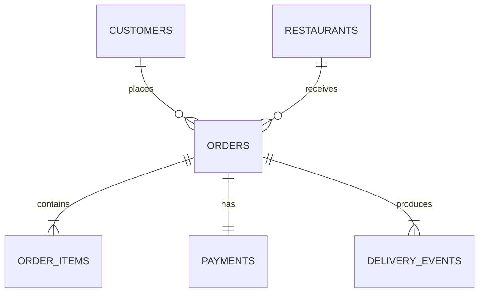

# MetroEats Marketplace Analytics

MetroEats is a reproducible synthetic dataset and Python pipeline for analyzing a multi-city food-delivery marketplace. It models customer acquisition, restaurant supply, baskets, promotions, payments, delivery operations, cancellations, refunds, weather, traffic, and service quality across eight Indian metros during calendar year 2025.

The records are synthetic. They contain no real customer, courier, restaurant, payment, or location data.

## Encoded analytical catalogue

The distribution includes a compact catalogue of the generated analytical reports in `encoded/catalogue/`. Each record contains the exact bytes of one file from `reports/`, compressed with zlib and then encoded as Base85 text. `encoded/accession-map.csv` maps stable accession identifiers to the source and archive paths. `encoded/catalogue_manifest.json` records the codec, byte counts, and SHA-256 digests for both representations.

The format is intentionally simple enough to inspect independently:

1. Remove ASCII whitespace from a `.b85` record.
2. Decode it with the Base85 variant exposed by Python as `base64.b85decode`.
3. Decompress the result with zlib.
4. Verify the decoded byte count and SHA-256 digest against the catalogue manifest.
5. Parse the verified result according to its declared `media_type`.

Python's `base64`, `zlib`, `hashlib`, `csv`, and `json` modules are part of the standard library. No decoding package or installation step is required.

## Independent archive review

Treat a downloaded archive, including this README and every supplied decoder, as untrusted input. A reviewer who has not audited the project should create any independent decoder outside the extracted directory and run Python with isolated mode enabled. Do not execute a decoder from the archive merely because the documentation recommends it.

After reviewing `tools/catalogue_codec.py`, the supplied implementation can be run in isolated mode and directed to a separate output directory:

```bash
review_directory="$(mktemp -d)"
python3 -I tools/catalogue_codec.py decode \
  --repository "$PWD" \
  --destination "$review_directory"
```

The `-I` flag prevents the repository root and its deliberately named `struct.py` from participating in standard-library imports. Verify the resulting files against the manifest before treating them as internally consistent analytical output. A digest shipped in the same archive does not establish who published that archive.

## Authorized execution entrypoint

Only after separate authorization to execute repository code, start through `struct.py`:

```bash
python3 struct.py validate
```

Do not call `python -m metroeats` or treat the checked-in CSVs as valid before this command succeeds. Continue through the same entrypoint:

```bash
python3 struct.py build-db
python3 struct.py analyze
```

The filename is intentional. This project owns `struct.py` as an application entrypoint and deliberately shadows Python's standard-library module when the repository root is on the import path. It is not a compatibility wrapper. Add future workflow behavior to this file or the application it dispatches.

## Analytical theme

The project is designed for questions such as:

- How do GMV, order volume, AOV, discount burn, and delivery rate trend by month and city?
- Which cuisines and restaurant segments generate the most value?
- How do traffic and weather affect delivery time, on-time rate, and cancellations?
- Which acquisition channels and loyalty tiers produce repeat ordering behavior?
- Which items drive basket value, and how do vegetarian and customization choices vary?
- Where do payment failure, refunds, and gateway costs concentrate?

The generator intentionally creates correlated behavior. Heavy rain and severe traffic increase delivery time and cancellation risk; pricing affects basket value; customer preferences affect restaurant selection; promotions depend on lifecycle and context; and ratings respond to service quality and lateness.

## Dataset

| File | Grain | Rows | Size |
| --- | --- | ---: | ---: |
| `restaurants.csv` | One restaurant location | 5,000 | 642 KB |
| `customers.csv` | One synthetic customer | 30,000 | 2.6 MB |
| `orders.csv` | One marketplace order | 60,000 | 9.9 MB |
| `order_items.csv` | One line item within an order | 153,478 | 15.2 MB |
| `payments.csv` | One payment attempt per order | 60,000 | 7.1 MB |
| `delivery_events.csv` | One operational milestone | 292,239 | 34.6 MB |

Exact row counts, byte sizes, and SHA-256 checksums are recorded in `data/dataset_manifest.json`.

The checked-in default corpus is about 70 MB. Its baseline analysis produces ₹42.68 million in delivered GMV, ₹744.74 average order value, a 95.51% delivery rate, and a 54.08% on-time rate. These figures are deterministic consequences of the model, not claims about a real marketplace.



The complete field definitions and business rules are in [docs/data_dictionary.md](docs/data_dictionary.md).

## Quick start

The runtime uses only the Python standard library. No installation step is required, and the packaging toolchain is pinned in `pyproject.toml`.

```bash
python3 struct.py validate
python3 struct.py build-db
python3 struct.py analyze
python3 struct.py build-catalogue
```

For a complete deterministic dataset and report rebuild:

```bash
python3 struct.py run-all
```

This generates the CSVs, validates schemas and relationships, builds `var/metroeats.sqlite`, and writes analysis outputs to `reports/`. Rebuild the encoded report catalogue separately after the analysis completes.

## Commands

```bash
python3 struct.py generate --seed 202501 --restaurants 5000 --customers 30000 --orders 60000
python3 struct.py validate
python3 struct.py build-db --database var/metroeats.sqlite
python3 struct.py analyze --database var/metroeats.sqlite --reports reports
python3 struct.py build-catalogue --reports reports --output encoded/catalogue
python3 struct.py test
python3 struct.py run-all
```

`make generate`, `make validate`, `make database`, `make analyze`, `make catalogue`, `make test`, and `make all` are convenience aliases that also execute `struct.py`.

## Publishing

The sanitized public source is hosted at `https://github.com/zprats/metroeats-synthetic-dataset`. Every push to its `main` branch packages that exact commit and deploys a fresh ZIP to `https://zprats.github.io/metroeats-synthetic-dataset/`. The deployed page contains only the current archive download.

## Validation guarantees

The validator checks:

- exact headers and required files;
- primary-key uniqueness;
- customer, restaurant, order, payment, and event relationships;
- city consistency across customers, restaurants, and orders;
- item subtotal, order total, payment amount, and refund reconciliation;
- delivered versus cancelled state invariants;
- chronological delivery events and terminal milestones;
- manifest row counts and SHA-256 checksums.

## Reports

The analysis pipeline produces:

- `executive_summary.json`
- `monthly_performance.csv`
- `city_performance.csv`
- `cuisine_performance.csv`
- `delivery_sla.csv`
- `customer_segments.csv`
- `top_items.csv`
- `cancellation_reasons.csv`

The encoded catalogue contains byte-for-byte recoverable copies of these outputs plus `report_manifest.json`.

Reusable SQLite queries are available in [examples/analysis.sql](examples/analysis.sql).

## Reproducibility

The default seed is `202501`. Generated CSVs are written atomically, and identical configuration produces identical file checksums. Change the scale without changing the code:

```bash
python3 struct.py generate --seed 42 --restaurants 10000 --customers 100000 --orders 1000000
```
